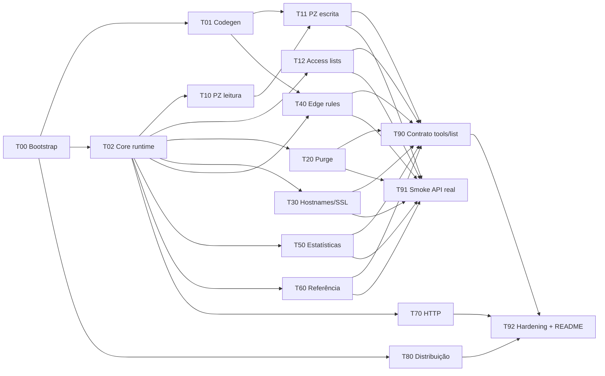

# Tasks — índice e grafo de dependências

Este índice é **estático**. O status vive no arquivo de cada task (`specs/tasks/Txx-*.md`), para que
agentes paralelos não editem o mesmo arquivo.

## Grafo

## Ondas de execução

| Onda | Tasks (paralelas entre si) | Agentes máx. | Pré-condição |
|---|---|---|---|
| **0a** | T00 | 1 | — |
| **0b** | T01 ∥ T02 ∥ T80 | 3 | T00 mergeada |
| **1** | T10 ∥ T12 ∥ T20 ∥ T30 ∥ T40\* ∥ T50 ∥ T60 ∥ T70 | 8 | T02 mergeada (\*T40 também T01) |
| **1b** | T11 | 1 | T10 + T01 mergeadas |
| **2** | T90 ∥ T91 | 2 | todas as tools mergeadas |
| **3** | T92 | 1 | T90, T70, T80 |

Caminho crítico: T00 → T02 → T10 → T11 → T90 → T92.

## Tabela de tasks

Perfil: nível do implementador / nível do revisor (A = Opus; B = Sonnet · Gemini 3.8 Flash).
Revisor sempre de **outro fornecedor** quando possível. Detalhes em [README](README.md#perfis-de-agente).

| ID | Título | Onda | Depende de | Arquivos possuídos (resumo) | Contrato | Perfil impl/rev |
|---|---|---|---|---|---|---|
| [T00](tasks/T00-bootstrap.md) | Bootstrap do workspace + CI | 0a | — | `Cargo.toml`, toolchain, CI, xtask skeleton | design §1–2 | A / — |
| [T01](tasks/T01-codegen.md) | Codegen da spec → `generated.rs` | 0b | T00 | `xtask/**`, `src/generated.rs` | design §9 | A·B / B |
| [T02](tasks/T02-core.md) | Runtime core: config, client, server, stdio, harness | 0b | T00 | arquivos congelados (C7) | design §3–8, §10, §12 | A / A |
| [T10](tasks/T10-pullzone-read.md) | Pull zones: list/get/check_availability | 1 | T02 | `tools/pullzone.rs`, `model/pullzone.rs` | TOOL-PZ-01,02,06 | B / B |
| [T11](tasks/T11-pullzone-write.md) | Pull zones: create/update/delete/reset key | 1b | T10, T01 | idem T10 | TOOL-PZ-03,04,05,07 | A·B / A |
| [T12](tasks/T12-access.md) | Listas de acesso | 1 | T02 | `tools/access.rs` | TOOL-AC-01 | B / B |
| [T20](tasks/T20-purge.md) | Purge | 1 | T02 | `tools/purge.rs` | TOOL-PG-01,02 | B / B |
| [T30](tasks/T30-hostname.md) | Hostnames & SSL | 1 | T02 | `tools/hostname.rs` | TOOL-HS-01…06 | B / B |
| [T40](tasks/T40-edgerule.md) | Edge rules | 1 | T02, T01 | `tools/edgerule.rs`, `model/edgerule.rs` | TOOL-ER-01…04 | A·B / A |
| [T50](tasks/T50-stats.md) | Estatísticas | 1 | T02 | `tools/stats.rs`, `model/stats.rs` | TOOL-ST-01,02 | B / B |
| [T60](tasks/T60-reference.md) | Regiões e países | 1 | T02 | `tools/reference.rs`, `model/reference.rs` | TOOL-RF-01,02 | B / B |
| [T70](tasks/T70-http.md) | Transporte Streamable HTTP | 1 | T02 | `transport/http.rs` | REQ-TR-02…06 | A / A |
| [T80](tasks/T80-distribution.md) | Release multi-plataforma, Homebrew, Docker | 0b | T00 | `Dockerfile`, `.github/workflows/release.yml`, `dist` config | REQ-NF-03…05 | B / A |
| [T90](tasks/T90-contract.md) | Teste de contrato `tools/list` + orçamento de tokens | 2 | todas tools | `tests/contract.rs`, snapshots | REQ-NF-02, REQ-OUT-05 | B / B |
| [T91](tasks/T91-smoke.md) | Smoke contra API real | 2 | todas tools | `tests/smoke.rs` | C6 | A / A |
| [T92](tasks/T92-hardening.md) | Medição de leveza, ajuste de deps, README | 3 | T90, T70, T80 | `README.md`, `docs/**` (+ CRs em congelados) | C1, REQ-NF-01 | A / B |
